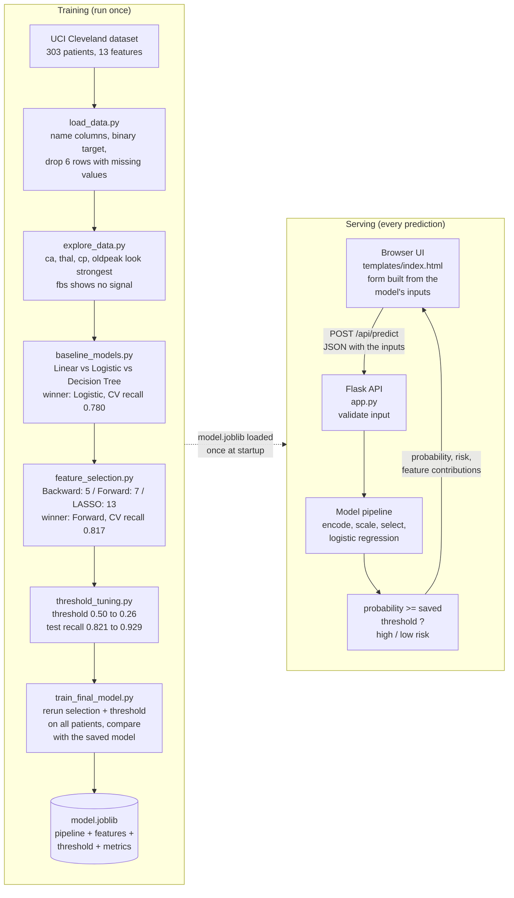
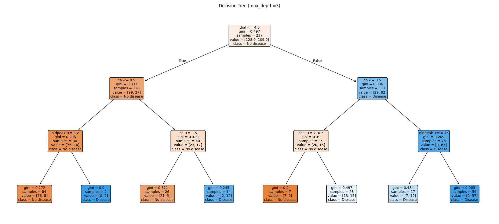
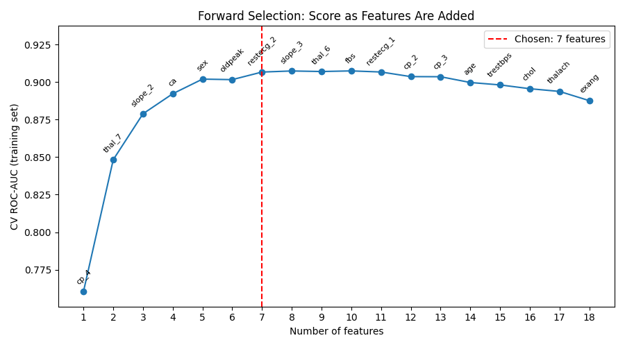
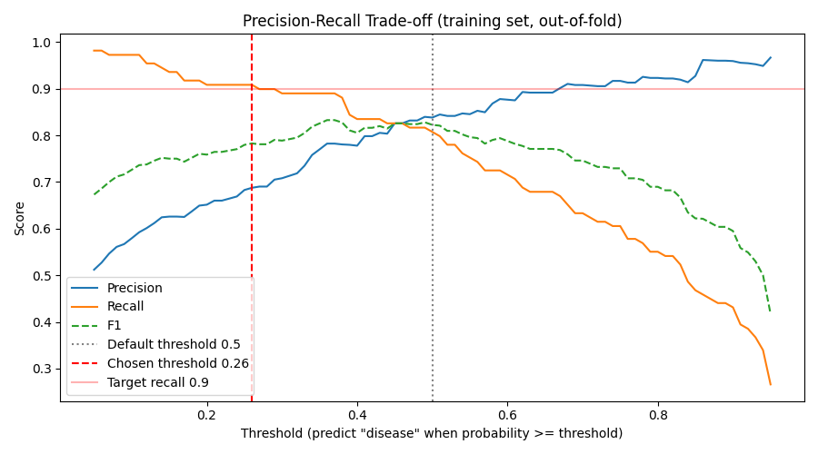
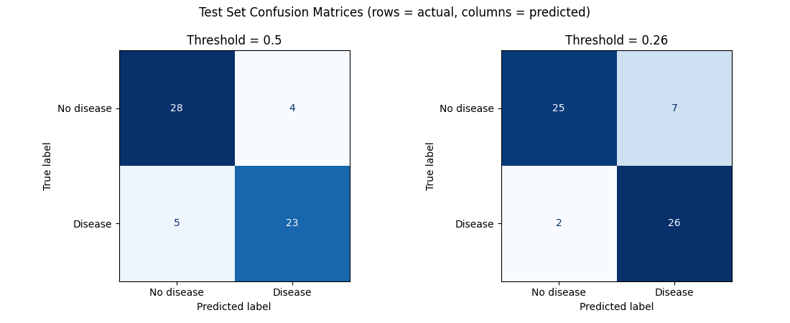

# Heart Disease Risk Classifier

Predict whether a patient has heart disease from 13 clinical measurements. I built this project to practice supervised learning end to end: **linear regression, logistic regression, decision trees, evaluation metrics, and feature selection** (backward elimination, forward selection and LASSO).

**Final model:** logistic regression on 7 features with a decision threshold of 0.26. On the held-out test set it **catches 26 of 28 sick patients (recall 0.929)**, with ROC-AUC 0.948.

---

## Project overview

The project has two halves. **Training** runs once, offline: each step narrows down the model and passes its decision to the next. **Serving** runs every time someone uses the app: it only loads the saved model and never retrains.



---

## Dataset

[UCI Heart Disease, Cleveland](https://archive.ics.uci.edu/dataset/45/heart+disease): 303 patients, 13 features.

- **Target:** the original `num` (0–4) is turned into binary: 0 = no disease, 1 = disease (any severity).
- **Classes:** roughly balanced, 54% no disease / 46% disease.
- **Missing values:** 6 rows (`ca`: 4, `thal`: 2). They're dropped, leaving 297 rows.
- **Duplicates:** none. The popular Kaggle `heart.csv` (1025 rows) is mostly duplicates of these same patients, which leaks between the train and test sets. That's why this project uses the original UCI file.

| Feature | Meaning |
|---|---|
| `age`, `sex` | Age in years; 1 = male, 0 = female |
| `cp` | Chest pain type (1 = typical angina, 2 = atypical, 3 = non-anginal, 4 = asymptomatic) |
| `trestbps` | Resting blood pressure (mm Hg) |
| `chol` | Serum cholesterol (mg/dl) |
| `fbs` | Fasting blood sugar > 120 mg/dl |
| `restecg` | Resting ECG (0 = normal, 1 = ST-T abnormality, 2 = LV hypertrophy) |
| `thalach` | Maximum heart rate achieved |
| `exang` | Exercise-induced angina |
| `oldpeak` | ST depression induced by exercise |
| `slope` | Slope of peak exercise ST segment (1 = up, 2 = flat, 3 = down) |
| `ca` | Number of major vessels colored by fluoroscopy (0–3) |
| `thal` | Thalassemia (3 = normal, 6 = fixed defect, 7 = reversible defect) |

---

## How to run

```bash
pip install -r requirements.txt
```

Run the scripts in order. The first one downloads the dataset into `data/`, and every script saves its plots into `plots/`.

```bash
python load_data.py          # Load the data and print a quick check
python explore_data.py       # Step 1: exploration (plots 1-4)
python baseline_models.py    # Step 2: baseline models (plots 5-6)
python feature_selection.py  # Step 3: feature selection (plots 7-8)
python threshold_tuning.py   # Step 4: threshold tuning (plots 9-11)
python train_final_model.py  # Step 5: train the final model on all patients -> model.joblib
python app.py                # Step 5: start the web app at http://localhost:5000
```

| File | What it does |
|---|---|
| `load_data.py` | Shared helpers: `load_data()`, `clean_data()`, `make_preprocessor()`, `make_logistic_model()` |
| `explore_data.py` | Class balance, feature distributions, disease rate per category, correlations |
| `baseline_models.py` | Linear regression, logistic regression and two decision trees, all on all features |
| `feature_selection.py` | Backward elimination, forward selection and LASSO, then retrains on each feature set |
| `threshold_tuning.py` | Picks a decision threshold that catches at least 90% of sick patients |
| `training.py` | The reusable procedure: backward elimination, forward selection, threshold tuning, `build_model()` |
| `train_final_model.py` | Reruns the whole procedure, compares with the saved model, and saves `model.joblib` |
| `app.py` | Flask server: serves the UI and the `/api/predict` endpoint |
| `templates/index.html` | The web UI (HTML, CSS and JavaScript in one file) |

**Setup used everywhere:** a stratified 80/20 train/test split (`random_state=42`, 237 train / 60 test) plus 5-fold stratified cross-validation. For linear models, the categorical features (`cp`, `restecg`, `slope`, `thal`) are one-hot encoded and the rest are scaled, inside a `Pipeline` so the preprocessing only ever learns from training data.

---

## Step 1: Exploration

The strongest signals, measured as the disease rate in each group:

| Feature | Pattern |
|---|---|
| `ca` | 26% → 68% → 82% → 85% as blocked vessels go from 0 to 3 |
| `thal` | Normal: 23% vs reversible defect: 77% |
| `cp` | Type 4 ("asymptomatic"): **73%**, while types 1–3 are only 18–30% |
| `exang` | 76% with exercise angina vs 32% without |
| `thalach` | Average max heart rate 139 with disease vs 159 without |
| `fbs` | **No signal**: 46% vs 47% |

**Lessons**
- **Correlation can mislead for categorical features.** `cp` has a correlation of 0.41, but the real pattern is "type 4 vs everything else", not a straight line from 1 to 4. That's why one-hot encoding is needed.
- **Small groups are unreliable.** `restecg = 1` shows a 75% disease rate, but from only 4 patients.

---

## Step 2: Baseline models (all features)

| Model (5-fold CV) | Accuracy | Recall | F1 | ROC-AUC |
|---|---|---|---|---|
| **Logistic Regression** | **0.821** | **0.780** | **0.801** | **0.900** |
| Decision Tree (depth 3) | 0.788 | 0.736 | 0.760 | 0.833 |
| Decision Tree (full) | 0.721 | 0.728 | 0.703 | 0.720 |



**Lessons**
- **Linear regression isn't a classifier.** Thresholded at 0.5 it scored 0.85 test accuracy, but **58 of its 297 predictions fell outside [0, 1]** (range −0.26 to 1.34), so they can't be read as probabilities. Logistic regression fixes this.
- **An unlimited decision tree overfits.** It scores 1.000 on the training set and 0.700 on the test set, with 40 leaves for 237 patients. Limiting it to depth 3 brings that to 0.844 / 0.800.
- **One small test split is noisy.** Logistic regression scored 0.85 test accuracy, but cross-validation gives 0.82 ± 0.055.
- **`age` got a coefficient of almost zero.** Its information is already carried by `thalach` and `ca`.

---

## Step 3: Feature selection

After one-hot encoding there are 18 features. Each method was run on the training set only.

| Method | How it decides | Kept |
|---|---|---|
| Backward elimination | Drop the highest p-value (`statsmodels.Logit`) until every p ≤ 0.05 | 5 |
| Forward selection | Add whichever feature most improves CV ROC-AUC; stop at the smallest set within 0.005 of the best | 7 |
| LASSO | L1 logistic regression (`l1_ratio=1`), with C chosen by CV (C = 0.82) | 13 |

**All three agree on 5 features:** `thal_7`, `cp_4`, `ca`, `oldpeak` and `restecg_2`. Forward selection adds `sex` and `slope_2`. **`age` is dropped by all three.**

| Feature set (logistic regression) | # features | CV recall | CV F1 | CV ROC-AUC |
|---|---|---|---|---|
| All features | 18 | 0.780 | 0.801 | 0.900 |
| Backward | 5 | 0.773 | 0.797 | 0.899 |
| **Forward** | **7** | **0.817** | **0.828** | **0.911** |
| LASSO | 13 | 0.794 | 0.804 | 0.903 |



**Lessons**
- **More features can make a model worse.** The forward selection score peaks around 7–10 features, then falls from 0.907 to 0.888 as weak features are added.
- **A p-value measures what a feature adds *given the others*.** `exang` and `thalach` both correlate with the target at about 0.42, but backward elimination dropped them because they overlap with `cp_4` and `oldpeak`.
- **"Significant" isn't the same as "predictive".** Backward elimination, the strictest method, had the lowest test recall (0.679).
- **LASSO balances sparsity against accuracy.** When C is chosen for the best ROC-AUC, it keeps more features than the other two methods.

---

## Step 4: Threshold tuning

The default rule, "disease if probability ≥ 0.5", treats a missed sick patient and a false alarm as equally bad. In medicine they aren't. The threshold was chosen from **out-of-fold probabilities on the training set** (never from the test set), as the highest threshold that still gives recall ≥ 0.90.

| Test set (28 sick, 32 healthy) | Threshold | Recall | Precision | Missed sick | False alarms | Accuracy |
|---|---|---|---|---|---|---|
| Default | 0.50 | 0.821 | 0.852 | 5 | 4 | 0.85 |
| Best F1 | 0.36 | 0.893 | 0.806 | 3 | 6 | 0.85 |
| **Recall ≥ 0.9** | **0.26** | **0.929** | **0.788** | **2** | **7** | **0.85** |





**Lessons**
- **The threshold is a choice, not a rule.** Lowering it to 0.26 cut missed sick patients from 5 to 2, at the cost of 3 extra false alarms.
- **Accuracy hides the trade-off.** All three rules score exactly 0.85 accuracy, yet they make very different mistakes.
- **ROC-AUC is the same at every threshold** (0.948). It measures how well the model ranks patients, and the threshold only decides where to cut that ranking.

---

## Step 5: Web app

### Training is automatic: nothing is hardcoded

`train_final_model.py` **recomputes the features and the threshold on every run**, so when the data grows the model adapts. To add patients, append rows to `data/heart_cleveland.csv` (same 14 columns) and run it again.

What is learned from data and what is fixed:

| Recalculated on every run | Fixed (a human decision, in `training.py`) |
|---|---|
| Which features to keep (forward selection) | `TARGET_RECALL = 0.90` |
| The threshold (highest with out-of-fold recall ≥ 0.90) | `FORWARD_TOLERANCE = 0.005` (when forward selection stops) |
| The coefficients | The method: forward selection + logistic regression |

Each run does four things:
1. **Evaluates the procedure honestly.** It runs the whole procedure (forward selection → threshold tuning → logistic regression) on the 80% training split only, then scores it once on the 20% test split.
2. **Builds the deployed model by running the same procedure on all patients.** The result can differ a little from step 1, and that's expected, because the test score measures the *procedure*, not one specific feature list. On the current 297 patients, for example, step 1 picks `restecg_2` but step 2 picks `thalach` instead.
3. **Compares the new model with the saved one:** features added or removed, threshold, test recall.
4. **Saves the model** with its features, the raw inputs it needs, the threshold and its test metrics. **If its test recall is lower than the current model's, it doesn't save** unless you pass `--force`.

```bash
python train_final_model.py --force
```

The procedure itself lives in [training.py](training.py) (`forward_selection()`, `tune_threshold()`, `build_model()`). `feature_selection.py` and `threshold_tuning.py` call the same functions, so the explanations and the deployed model can never drift apart.

### The app follows the model

`app.py` loads `model.joblib` once at startup. **It has no constants about the model.** The threshold and the list of inputs both come from the file:

| Endpoint | What it does |
|---|---|
| `GET /` | The UI |
| `GET /api/model-info` | Inputs the model needs, threshold, test metrics, number of patients, training time |
| `POST /api/predict` | Takes the model's inputs as JSON and returns the probability, the risk label and per-feature contributions |

The UI knows how to draw all 13 possible inputs. At start-up it asks `/api/model-info` which ones the current model needs and **only shows those**. If a retrained model picks different features, the form changes with it.

Example request for the current model (check `/api/model-info` for its inputs):

```bash
curl -X POST http://localhost:5000/api/predict -H "Content-Type: application/json" -d "{\"sex\": 1, \"cp\": 4, \"thalach\": 118, \"oldpeak\": 2.5, \"slope\": 2, \"ca\": 2, \"thal\": 7}"
```

**How a prediction is explained:** in logistic regression the log-odds are a sum of `coefficient × feature`. The app shows each feature's `coefficient × (patient value − average patient value)`, which is how far that feature pushes this patient's risk above or below an average patient.

**Lessons**
- **Train once, predict many times.** The app never retrains; it only loads `model.joblib`.
- **The pipeline makes deployment safe.** The encoding and scaling are saved inside the model, so the app sends raw values and can't apply them differently from training.
- **A `lambda` can't be saved with joblib.** The column-selection step uses a named function (`select_columns` in `load_data.py`) instead.
- **Decide what's a decision and what's learned.** The 0.26 threshold isn't the goal, "catch 90% of sick patients" is. Hardcoding the 0.26 would silently go stale as the data grows.
- **Fix the category codes.** The one-hot encoder is given every possible code up front, so a rare code (`restecg = 1` has 4 patients) missing from a split can't change the feature columns.
- **Validate inputs at the API.** Unknown codes, booleans, missing values and out-of-range numbers are rejected with a 400 error that explains the problem.

---

## Conclusions

1. **Best procedure:** forward selection, then logistic regression, with the threshold tuned for recall ≥ 0.90. On the training split it chose 7 features (`cp_4`, `thal_7`, `slope_2`, `ca`, `sex`, `oldpeak`, `restecg_2`) and a threshold of 0.26. The deployed model, trained on all 297 patients, swaps `restecg_2` for `thalach`.
2. **Most important risk factors:** reversible thalassemia defect, asymptomatic chest pain, the number of blocked vessels, and ST depression during exercise. Every method agreed on these.
3. **Simple and interpretable beat complex here.** Logistic regression outperformed both decision trees, and 7 features outperformed all 18.
4. **The metric has to fit the problem.** For a screening task, recall comes first, and accuracy alone would have hidden every important difference.

## Limitations

- **The dataset is small** (297 patients, 60 in the test set), so a single misclassified patient moves test recall by about 3.6 points.
- **Feature selection results are slightly optimistic.** The CV numbers for the selected sets were computed after selection had already seen the training data. Nested cross-validation would remove that bias.
- **It's one hospital (Cleveland) from 1988.** The model may not carry over to other populations.
- **This is a learning project, not a medical tool.**

## Ideas for next steps

- Nested cross-validation for an unbiased estimate of the feature-selection results
- Random Forest and Gradient Boosting, to compare with the single decision tree
- Hyperparameter tuning with `GridSearchCV` (tree depth, LASSO C)
- Probability calibration, so a "30% risk" really means 30%
- Postman tests for `/api/predict`, covering valid patients and every validation error
